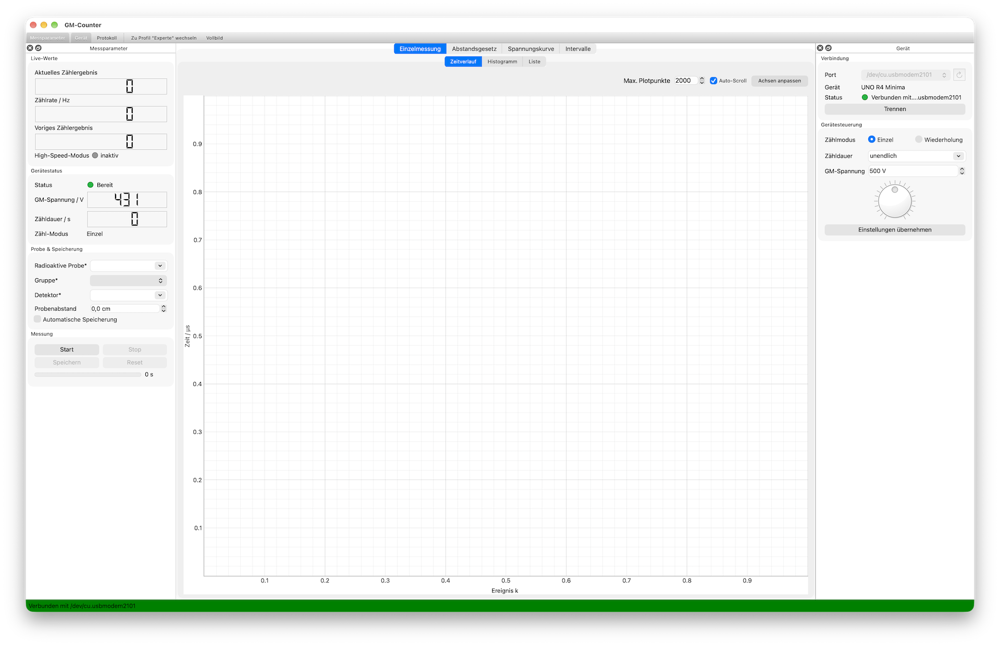
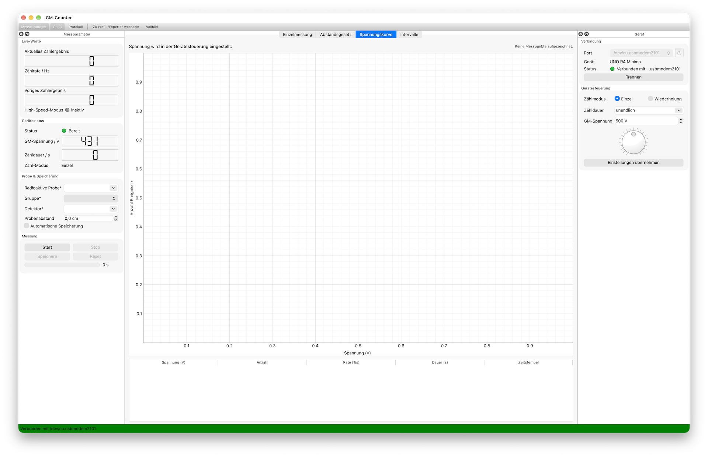

# GMCounter

Desktop application for a Geiger-Müller counter on USB serial. GMCounter records the time between two detector events in microseconds, shows the data live, and saves it for analysis. It is built for random-number research and for lab courses on radioactivity and detector characterization.



The screenshots show the `student` profile (Praktikum), which is the default. The interface language is German.

## Quick start

```bash
pip install "git+https://github.com/cckssr/gmcounter.git"
gmcounter --simulate     # simulated counter, no hardware needed
```

`gmcounter` opens the reduced Praktikum interface; add `--profile expert` for every control. Click **Verbinden** in the connection panel (top right) to connect to the simulated device, set the counting time and voltage, and press **Start**. With a real counter, leave out `--simulate`, pick the serial port in the connection panel and connect.

## Experiments

Each experiment is a tab in the central area. All tabs share the Start, Stop, Save and Reset buttons.

| Tab                | What it measures                                                                                                                                                                                                          |
| ------------------ | ------------------------------------------------------------------------------------------------------------------------------------------------------------------------------------------------------------------------- |
| **Einzelmessung**  | One measurement of inter-event times, shown as time series, histogram or list. At high count rates the line plot and table pause while the histogram and readouts keep updating, and no event is dropped from the export. |
| **Abstandsgesetz** | Distance law: count rate over the source distance. The points of several measurements form one session, saved together at the end.                                                                                        |
| **Spannungskurve** | Voltage response (Geiger plateau): count rate over the counter voltage, one point per measurement.                                                                                                                        |
| **Intervalle**     | One continuous acquisition, binned into R equal-width time intervals with live plots.                                                                                                                                     |



Data is saved as CSV with a sidecar `*_MD.json` file that holds the metadata (sample, detector, group, distance, settings). While a measurement runs, every data point is also appended to a crash-safe journal in `~/.gmcounter/sessions/`, so an interrupted session can be found again on the next start. If the USB link drops, the application reconnects on its own and restores the voltage, counting time and mode.

## Profiles

| Profile             | For                      | Interface                                                                                                     |
| ------------------- | ------------------------ | ------------------------------------------------------------------------------------------------------------- |
| `student` (default) | Lab courses (Praktikum)  | Reduced controls, with the same experiments. The baud rate, the query mode and some readback rows are hidden. |
| `expert`            | Research and development | Every control.                                                                                                |

`gmcounter` starts the `student` profile. Ask for every control with:

```bash
gmcounter --profile expert
```

`gmcounter --help` lists the options and names the default. The toolbar switches the profile while the application runs. A profile is configuration only: `application.profile` in `gmcounter/config.json` sets the default and `profiles` defines each one.

## Installation

Python 3.10 or newer is required. Hardware operation needs a GM counter with the firmware from [`firmware/`](firmware/) on a supported Arduino board, connected over USB.

```bash
# From GitHub; add @main or @v3.0.0 to pin a branch or release
pip install "git+https://github.com/cckssr/gmcounter.git"

# From a local clone
pip install .

# For development (editable, with ruff and the test tools)
pip install -e ".[dev]"
```

Start the application with `gmcounter` or `python -m gmcounter`. `--simulate` needs a source checkout (the mock device is not part of the wheel) and macOS or Linux.

## Hardware and protocol

The application talks SCPI over USB serial (1,000,000 baud by default) to the Arduino firmware, which in turn drives the GM counter board. Measurements stream as binary packets, each carrying the time since the previous event in firmware timer ticks. The command set and the packet format are described in [`docs/hardware/gm-counter-protocol.rst`](docs/hardware/gm-counter-protocol.rst) (German).

## Development

```bash
ruff format gmcounter tests
ruff check gmcounter tests --ignore D100,D101,D102,D103,D104,D105,D106,D107

pytest                                       # everything
QT_QPA_PLATFORM=offscreen pytest tests/ui/   # UI tests without a display
pytest --cov=gmcounter
```

The code has three layers with a strict dependency direction, `ui` → `infrastructure` → `core`. The user interface follows a Designer-first rule: every static widget lives in a `.ui` file, and every German text lives in `gmcounter/config.json`.

```bash
bash gmcounter/pyqt/pyuic.sh            # regenerate the ui_<form>.py modules
python -m gmcounter.pyqt.preview        # list the forms; add a name to show one
```

| Where                                          | What                                                            |
| ---------------------------------------------- | --------------------------------------------------------------- |
| [`ARCHITECTURE.md`](ARCHITECTURE.md)           | Layers, threads, reconnect and data flow                        |
| [`CLAUDE.md`](CLAUDE.md)                       | Module map, conventions, how to add a tab, CI and release rules |
| [`CHANGELOG.md`](CHANGELOG.md)                 | What changed in each release                                    |
| [`.github/WORKFLOWS.md`](.github/WORKFLOWS.md) | CI and release workflows                                        |

## Contributing and releases

Open a pull request against `main`. CI checks formatting, lint and the tests on Python 3.10 to 3.12. Add your change under `## [Unreleased]` in [`CHANGELOG.md`](CHANGELOG.md). A maintainer releases by adding one of the labels `major`, `minor` or `patch` to the PR before merging: the release workflow then bumps the version, tags it and publishes the release. Without a label, nothing is released.

## Documentation

The full documentation is published at [gmcounter.readthedocs.io](https://gmcounter.readthedocs.io).

## License

MIT License. See [LICENSE](LICENSE).
